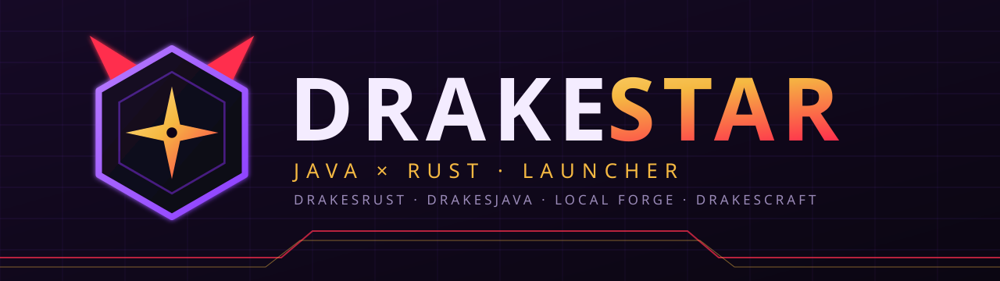

<p align="center"></p>

<p align="center">
  
  
  <a href="LICENSE"></a>
</p>

# DrakeStar — the Java × Rust hybrid launcher of the Drakes ecosystem

[🇬🇧 English](README.md) · [🇪🇸 Español](README_ES.md)

**DrakeStar** (Drakes + JackStar) is the sister launcher of the [DrakesPurpur Hybrid Engine](https://github.com/SlimefunNewHorizons/DrakesPurpur): one product to **play, test and manage** the whole Drakes/Slimefun ecosystem — Rust client, Java client, local server and online server — with its own visual identity. The hybrid Java × Rust DrakesPurpur engine already runs in production on the DrakesCraft server (Dallas).

> **Status: v0.4.0-alpha.** Profiles persisted to disk, validation with `drakestar-core`, import/export, mode picker that respects the compatibility matrix, instance management, server-driven delta modpack sync with SHA-256 verification (`modsync.rs`), a pre-launch Fabric/Mixin conflict analyzer, a mod loader with native adapter and hook engine, and a C-ABI intermediary so native (Rust) mods run next to Java ones. Local Forge (local DrakesPurpur server) is implemented; DrakesJava and DrakesRust launching are still pending.

## Modes

| Mode | What it does | Status |
|---|---|---|
| **DrakesRust** | Launches a Rust client (Horizon-like). Own profiles, LOD / high performance. **Does not load Java mods.** | profiles/channel/resolution only; no client yet, cannot launch |
| **DrakesJava** | Vanilla/Fabric/Forge/NeoForge Java profiles, modpacks, JVM and memory, import/export. | profiles and validation; launch pending |
| **Local Forge** | Starts a local DrakesPurpur with a Slimefun preset; logs, console, plugins, worlds. | implemented: start/stop, console, logs, EULA, properties, plugins, Slimefun preset, worlds and backups |
| **Online** | DrakesCraft connection profiles, quick links, server status. | profiles + TCP ping and Server List Ping `0x00` (MOTD, version, players); connecting needs a client (pending) |

## Real compatibility

Single source of truth: [`compat.rs`](crates/drakestar-core/src/compat.rs) (the UI and the CLI read it; `drakestar compat`).

| | Fabric/Forge/NeoForge mods | Server plugins (Slimefun…) | Slimefun GUIs/items |
|---|---|---|---|
| **DrakesJava** client | planned (not implemented) | yes (server side) | yes, with a vanilla client |
| **DrakesRust** client | **never** (different runtime) | yes, at server level | **unverified** (needs a full inventory protocol in the client) |

A `drakes-rust` profile with a loader or modpack is rejected (covered by a test). Horizon (MIT) speaks protocol 26.3 and DrakesPurpur 26.2; until it is tested with a real client, nothing claims that a Horizon/Rust client connects to DrakesPurpur 26.2.

## Channels

`stable` (default, verified releases only) · `unstable` (integration branch builds) · `nightly` (experimental, may break). Each profile declares a channel; a `stable` profile never resolves a `nightly` release (tested). See [docs/RELEASES.md](docs/RELEASES.md).

## Relationship with DrakesPurpur Hybrid

Local Forge runs the DrakesPurpur JAR (Java 25; the hybrid engine extracts its native Rust library from the JAR itself). The launcher does not duplicate engine logic: it downloads it by channel (SHA-256), configures it with a preset and supervises it. Measured engine results live in the DrakesPurpur repository.

## Manifest

`manifest.json` lists releases with URL, size and SHA-256. `python3 tools/verify_manifest.py` downloads every artifact and compares them; `--fix` rewrites the real values (the `nightly` channel changes with every build, so verify before publishing).

## Run

Requirements: stable Rust, Node 22+, Java 25 for a DrakesPurpur 26.x server, and on Linux the Tauri 2 dependencies (`libwebkit2gtk-4.1-dev build-essential libxdo-dev libssl-dev libayatana-appindicator3-dev librsvg2-dev pkg-config`).

```bash
# Desktop app (dev)
(cd ui && npm install) && ui/node_modules/.bin/tauri dev

# UI only in the browser, MOCK backend (flagged on screen)
cd ui && npm install && npm run dev

# Verification
cargo test --workspace          # core 48 + net 7 verified; app/tauri need GTK/WebKit
cargo run -p drakestar-cli -- profile-check examples/profile-local-dev.json
cargo run -p drakestar-cli -- manifest-check manifest.json
```

App data: `<app data dir>/profiles/<id>/{profile.json,server/,instance/,logs/}`, `settings.json`, `manifest.json`, `exports/`. Override with `DRAKESTAR_DATA_DIR`. No installers yet (`bundle.active=false`).

## Layout

`crates/drakestar-core` (model, channels, manifest, compat) · `crates/drakestar-net` (https download + streaming SHA-256) · `crates/drakestar-app` (profiles, processes, local server, backups, instances, releases, ping, modsync; no Tauri dependency) · `src-tauri` (Tauri 2 glue) · `ui/` (Svelte 5 + TypeScript + Vite) · `crates/drakestar-rust-client`, `drakestar-native-example`, `drakestar-cli`.

## Credits and license

MIT. Conceptually inspired by [Horizon](https://github.com/horizon-rust/horizon) (MIT); this repo copies neither its code nor its brand. Docs: [ARCHITECTURE](docs/ARCHITECTURE.md) · [PROFILES](docs/PROFILES.md) · [RELEASES](docs/RELEASES.md) · [BRANDING](docs/BRANDING.md) · [ROADMAP](docs/ROADMAP.md).
