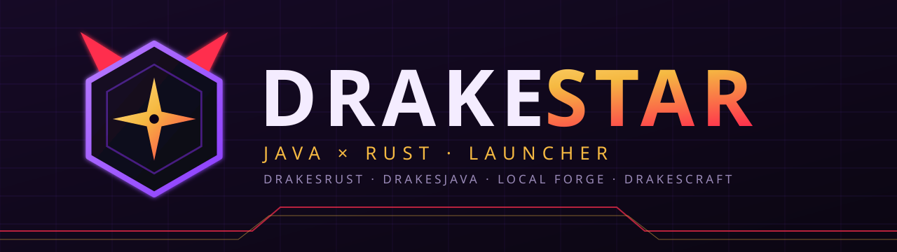
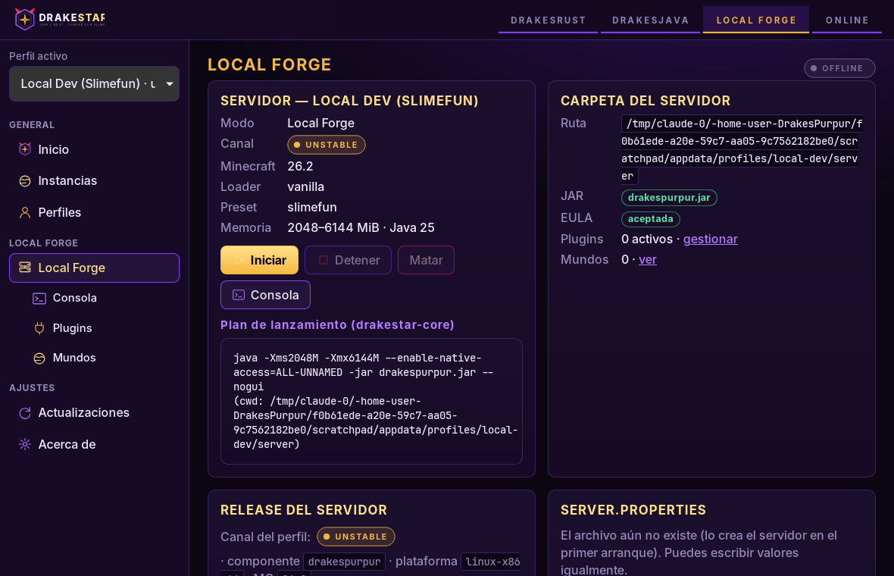
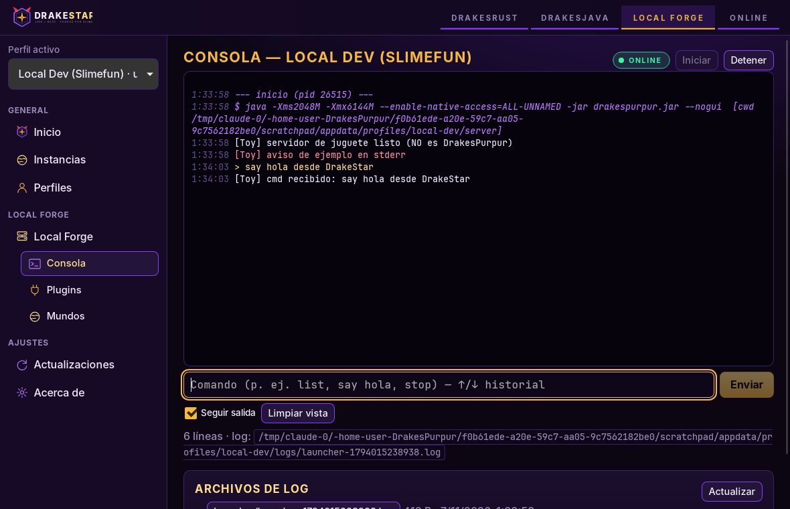
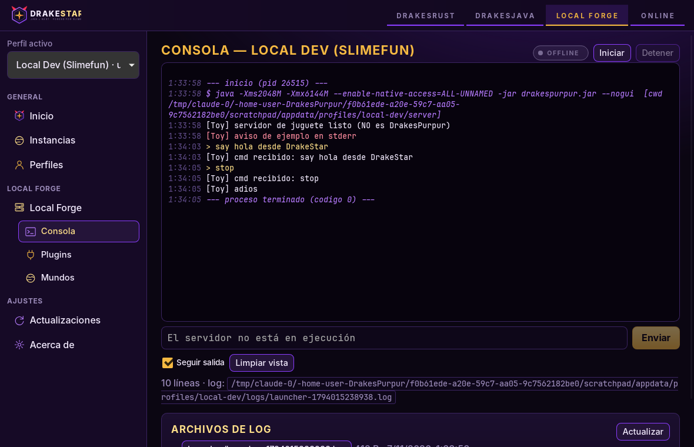
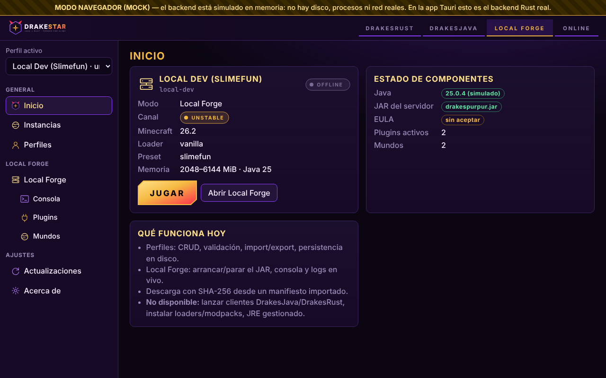
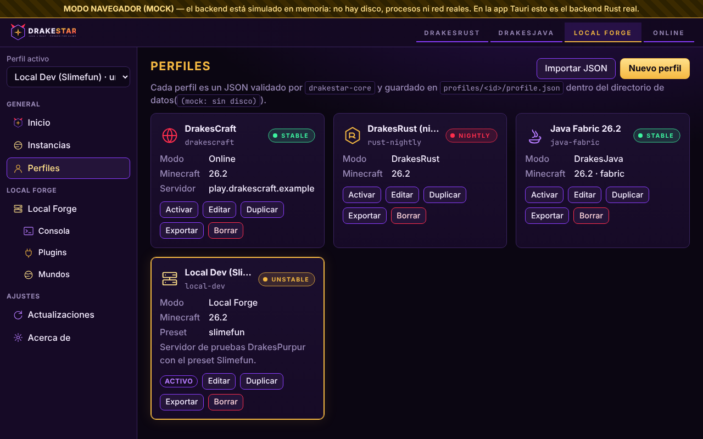
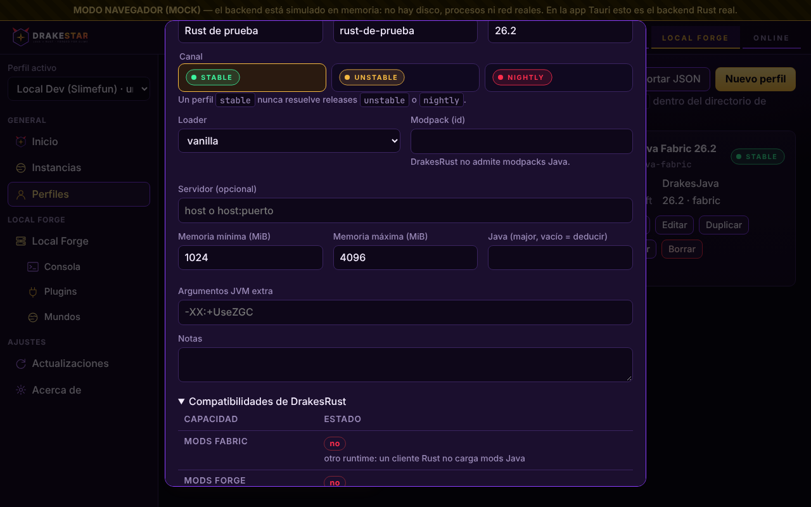
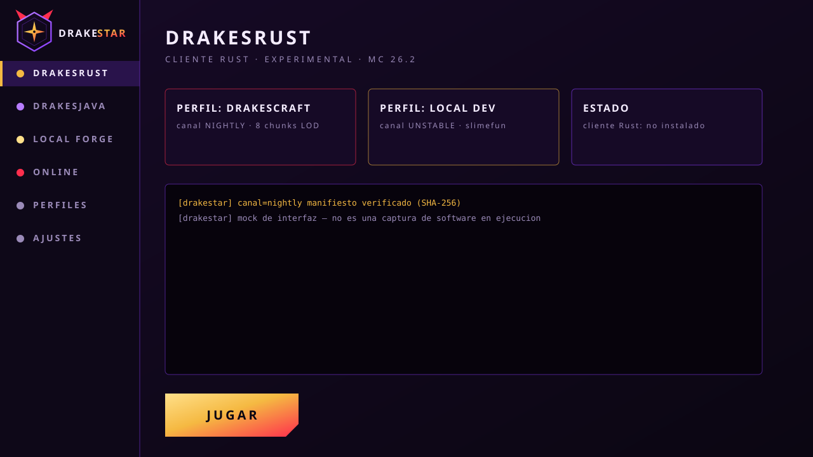

<p align="center"></p>

<p align="center">
  
  
  <a href="LICENSE"></a>
</p>

# DrakeStar — el launcher híbrido Java × Rust del ecosistema Drakes

**DrakeStar** (Drakes + JackStar) es el launcher hermano de [DrakesPurpur Hybrid Engine](https://github.com/SlimefunNewHorizons/DrakesPurpur): un solo producto para **jugar, probar y administrar** todo el ecosistema Drakes/Slimefun — cliente Rust, cliente Java, servidor local y servidor online — con identidad visual propia.

> **Estado: v0.4.0-alpha — el launcher decide qué mods carga, y ejecuta mods nativos además de Java.** Funciona de verdad: perfiles con persistencia en disco, validación con `drakestar-core`, import/export, selector de modo respetando la matriz de compatibilidad, administración de instancias, **sincronización delta server-driven de modpacks con verificación SHA-256 (`modsync.rs`)**, **analizador pre-arranque de dependencias, conflictos, ids duplicados y colisiones de clases objetivo de Mixin**, **arranque/parada del JAR de un servidor local con consola en vivo, stdin y logs en disco**, gestión de la carpeta del servidor (EULA, `server.properties`, plugins, preset Slimefun, mundos y copias de seguridad), protocolo de estado de Minecraft (**SLP `0x00`** + ping TCP), resolución de releases por canal y descarga verificada, **cliente Java con Fabric instalado y lanzado por el launcher (Mojang + Fabric verificados por hash)**, **sistema de mods propio: manifiesto `fabric.mod.json` sin modificar, dialecto semver de Fabric, resolución de dependencias y cargador que verifica SHA-256 por mod y decide qué entra**, **intermediario con ABI versionado y catálogo de hooks**, **adaptador nativo (`cdylib`) y motor de hooks que ejecuta mods Rust de punta a punta**, **cliente Rust nativo (`drakestar-rust-client`) que el launcher instala por canal y lanza, probado contra un mini-servidor de login**. 121/121 tests en Rust passing (`cargo test --workspace`), `svelte-check` sin errores. Ver [ROADMAP](docs/ROADMAP.md) e [INTERMEDIARIO](docs/INTERMEDIARIO.md).

## Capturas

Capturas de la **app Tauri real** (backend Rust, proceso Java real; el «servidor» es un JAR de juguete que hace eco, **no es DrakesPurpur**), tomadas en Linux con Xvfb:

| Local Forge | Consola en vivo | Tras `stop` |
|---|---|---|
|  |  |  |

Capturas de la misma UI en **modo navegador con backend simulado (MOCK)** — la barra amarilla lo indica; no hay disco ni procesos reales (script: [`tools/screenshots.cjs`](tools/screenshots.cjs)):

| Inicio | Perfiles | Editor (DrakesRust: loaders bloqueados, «sin verificar») |
|---|---|---|
|  |  |  |

Más en [`docs/screenshots/`](docs/screenshots/) (DrakesRust, actualizaciones, instancias, móvil). `assets/brand/mockups/main-window.svg` sigue siendo un mockup de diseño.

## Modos

| Modo | Icono | Qué hace | Estado |
|---|---|---|---|
| **DrakesRust** |  | Lanza un cliente Rust (Horizon-like). Perfiles propios, LOD/alto rendimiento. **No carga mods Java.** | solo perfiles/canal/resolución; **sin cliente, no se puede lanzar** |
| **DrakesJava** |  | Perfiles Java vanilla/Fabric/Forge/NeoForge, modpacks, JVM y memoria, import/export. | perfiles y validación; **lanzamiento pendiente** |
| **Local Forge** |  | Levanta un DrakesPurpur local con preset Slimefun; logs, consola, plugins, mundos. | **implementado**: arrancar/parar, consola, logs, EULA, properties, plugins, preset Slimefun, mundos y backups |
| **Online** |  | Perfiles de conexión a DrakesCraft y accesos rápidos, estado del servidor. | perfiles + ping TCP y **Server List Ping `0x00` (MOTD, versión, jugadores)**; conectar requiere un cliente (pendiente) |

<p align="center"></p>

## Compatibilidades reales

Una sola fuente de verdad: [`compat.rs`](crates/drakestar-core/src/compat.rs) (la UI y el CLI leen de ahí; `drakestar compat`).

| | Mods Fabric/Forge/NeoForge | Plugins de servidor (Slimefun…) | GUIs/ítems de Slimefun |
|---|---|---|---|
| Cliente **DrakesJava** | previsto (no implementado) | sí (son del servidor) | sí, con cliente vanilla |
| Cliente **DrakesRust** | **no, nunca** (otro runtime) | sí, a nivel de servidor | **sin verificar** (requiere protocolo de inventarios completo en el cliente) |

- Los **plugins** (Slimefun, StarSuites) corren en el **servidor**; el cliente solo necesita hablar el protocolo.
- Los **mods/modpacks Java** solo existen en DrakesJava. Un perfil `drakes-rust` con loader o modpack **se rechaza** (test incluido).
- Horizon (MIT) está en protocolo 26.3 y DrakesPurpur en 26.2; la relación está en el repositorio de DrakesPurpur (`docs/hybrid/CLIENTE_HORIZON.md`). Hasta probarlo con un cliente real, **no se afirma** que un cliente Horizon/Rust conecte a DrakesPurpur 26.2.

## Canales

| Canal | Pill | Quién lo usa |
|---|---|---|
| `stable` |  | por defecto; solo releases verificadas |
| `unstable` |  | builds de la rama de integración |
| `nightly` |  | experimental, puede romper |

Cada **perfil declara un canal**; un perfil `stable` jamás resuelve una release `nightly` (test incluido). Detalle: [docs/RELEASES.md](docs/RELEASES.md).

## Relación con DrakesPurpur Hybrid

Local Forge ejecuta el JAR de DrakesPurpur (Java 25; el motor híbrido extrae su biblioteca nativa Rust del propio JAR). Ese motor híbrido Java × Rust ya corre en producción en el servidor DrakesCraft (Dallas). El launcher no duplica lógica del motor: lo descarga por canal (SHA-256), lo configura con un preset y lo supervisa. Los resultados medidos del motor están en el repo de DrakesPurpur, no aquí.

## Ejecutar

Requisitos: Rust estable, Node 22+, y en Linux las dependencias de Tauri 2 (`sudo apt-get install libwebkit2gtk-4.1-dev build-essential libxdo-dev libssl-dev libayatana-appindicator3-dev librsvg2-dev pkg-config`). Java 25 para arrancar un servidor DrakesPurpur 26.x.

```bash
# App de escritorio (dev): arranca Vite y la ventana Tauri
(cd ui && npm install) && ui/node_modules/.bin/tauri dev   # desde la raiz del repo

# Solo la UI en el navegador, con backend MOCK (marcado en pantalla)
cd ui && npm install && npm run dev            # http://localhost:5173

# Verificación
cd ui && npm run build                          # svelte-check (TypeScript) + vite build
cargo test --workspace                          # core 48 + net 7 verificados; app/tauri requieren GTK/WebKit
cargo run -p drakestar-cli -- profile-check examples/profile-local-dev.json
cargo run -p drakestar-cli -- compat
```

Datos de la app: `<app data dir>/profiles/<id>/{profile.json,server/,instance/,logs/}`, `settings.json`, `manifest.json`, `exports/`. Se puede forzar otro directorio con `DRAKESTAR_DATA_DIR`. No hay instaladores/bundles todavía (`bundle.active=false`).

## Estructura

| Crate / carpeta | Rol | Tests |
|---|---|---|
| `crates/drakestar-core` | modelo, canales, manifiesto, plan, **compat** (fuente de verdad) | 48 |
| `crates/drakestar-net` | descarga https + SHA-256 en streaming, `.part` → rename solo si coincide | 7 |
| `crates/drakestar-app` | almacén de perfiles, gestor de procesos (Unix + Windows), servidor local, backups, preset Slimefun, instancias, releases, ping TCP + SLP `0x00`, delta modpack sync (`modsync.rs`) y analizador de conflictos Mixin/Fabric en Rust, Java. **Sin dependencia de Tauri** | 34 |
| `src-tauri` | glue Tauri 2: comandos IPC + eventos `proc-event` | compila (`cargo check`) |
| `ui/` | Svelte 5 + TypeScript + Vite; SVG de `assets/brand` copiados por `npm run sync-brand` | `svelte-check` |

## Marca

Cyberpunk dorado · morado · rojo. Todo vectorial y regenerable (`python3 tools/gen_brand.py`): logo, isotipo, banner, splash, 14 iconos, pastillas de estado/canal, botones, tabs y mockup. Guía: [docs/BRANDING.md](docs/BRANDING.md).

## Manifiesto

`manifest.json` lista las releases con URL, tamaño y SHA-256. `python3 tools/verify_manifest.py` descarga cada artefacto y compara; con `--fix` reescribe los valores reales (el canal `nightly` cambia con cada build, así que hay que verificarlo antes de publicar).

## Documentación

[ARQUITECTURA](docs/ARCHITECTURE.md) · [PERFILES](docs/PROFILES.md) · [RELEASES](docs/RELEASES.md) · [BRANDING](docs/BRANDING.md) · [ROADMAP](docs/ROADMAP.md) · rutas de UI (las usa el router): [`ui/routes.json`](ui/routes.json)

## Créditos y licencia

MIT. Inspirado conceptualmente en [Horizon](https://github.com/horizon-rust/horizon) (MIT); este repo no copia su código ni su marca. Si en el futuro se reutiliza código de Horizon, se conservará su aviso de licencia.
